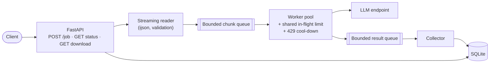

# Batch Inference Engine

An asynchronous REST service that reads a local JSON file of prompts, returns a Job ID immediately, fans the prompts out across a bounded worker pool calling a live LLM endpoint, survives rate limiting without dropping prompts, isolates per-row failures, and serves a structured report.

- **Problem statement:** [docs/spec.md](docs/spec.md)
- **Architecture and design (with diagrams):** [docs/design.md](docs/design.md)
- **Session history and working notes:** [docs/history.md](docs/history.md), [docs/notes/](docs/notes/README.md)



## Quickstart

Requires Python 3.12+. All commands run from `project/`.

```bash
cd project
python3 -m venv .venv && source .venv/bin/activate
pip install -e ".[dev]"

# 1,000-prompt input (already committed; regenerate any time, 5 rows are deliberately invalid)
python scripts/make_sample.py
```

### Option A: run against the local mock provider (no API key needed)

```bash
# terminal 1: fake LLM endpoint with 10% 429s and 2% 500s
uvicorn --app-dir scripts mock_inference:app --port 9000

# terminal 2: the service
INFERENCE_BASE_URL=http://127.0.0.1:9000/v1 uvicorn --app-dir src --factory batch_engine.api:create_app --port 8000
```

### Option B: run against a live endpoint

Put the key in `project/.env` (git-ignored):

```bash
INFERENCE_API_KEY=your-model-access-key
# optional, these are the defaults:
INFERENCE_BASE_URL=https://inference.do-ai.run/v1
INFERENCE_MODEL=llama3-8b-instruct
```

```bash
uvicorn --app-dir src --factory batch_engine.api:create_app --port 8000
```

### Submit the 1,000-prompt batch and fetch the report

```bash
JOB=$(curl -s -X POST localhost:8000/job -H 'Content-Type: application/json' -d '{}' | jq -r .job_id)
curl -s localhost:8000/job/$JOB/status | jq          # poll until status is completed / completed_with_errors
curl -s localhost:8000/job/$JOB/download -o report.json
jq '.summary, .errors' report.json
```

A sample run against the mock provider took about 20 seconds: 995 rows succeeded and 5 failed. The 5 failures are the deliberately invalid rows. It recorded 116 rate-limit retries and 26 server-error retries, with **zero prompts dropped**.

## Live deployment (DigitalOcean App Platform)

The service runs at **https://batch-inference-engine-ibptc.ondigitalocean.app** in project `akhrot-interview-2`, region `blr`. The spec is in [.do/app.yaml](.do/app.yaml), which deploys with the bundled mock as an internal-only service.

The live app now calls **DigitalOcean serverless inference with `mistral-3-14B`**. It was chosen as the cheapest current-generation model, at about $0.03 per 1,000 prompts; see [docs/notes/07-deployment.md](docs/notes/07-deployment.md). The key is set as an encrypted App Platform secret and is not in the repo. Two real 1,000-prompt runs:

- **Defaults (32 in flight, 8 retries for 429s):** 955 ok, 5 invalid, and 40 `rate_limited`. Those 40 were isolated, not lost, after 3,302 429 retries.
- **Tuned (`MAX_IN_FLIGHT=8` on the app, plus `{"retry": {"rate_limit": {"max_retries": 20, "max_delay_s": 60}}}` on the job):** **995 ok, the 5 invalid rows, and zero rate-limit failures**, with 1,754 429 retries, in 6 min 41 s.

```bash
U=https://batch-inference-engine-ibptc.ondigitalocean.app
JOB=$(curl -s -X POST $U/job -H 'Content-Type: application/json' -d '{}' | jq -r .job_id)
curl -s $U/job/$JOB/status | jq
curl -s $U/job/$JOB/download | jq .summary
```

Verified run: 1,000 rows in about 30 s. 995 succeeded, and the 5 failures were exactly the deliberately invalid rows. The service absorbed 111 rate-limit retries and 21 server-error retries from the mock with zero drops. The reader stayed at most about 600 rows ahead of the workers, which is the bounded-queue backpressure working.

Redeploy with `doctl apps create-deployment 33d7abde-59c4-44d3-92ad-6e401d19a631`. The API must run as **one instance** (in-process queue and local SQLite), so job history resets on each deploy.

## API

| Method and path | Description |
|---|---|
| `POST /job` | Start a job. Returns `202` with `job_id`, `status_url` and `download_url`. Body (all optional): `input_path` (relative to `DATA_DIR`, default `sample_batch.json`), `model`, `chunk_size`, `webhook_url`, and `retry.rate_limit` / `retry.server_error` overrides. |
| `GET /job/{id}/status` | Progress: `rows_read`, `total` (known once ingestion finishes), `succeeded`, `failed`, and retry counts per error class. |
| `GET /job/{id}/download` | Streamed JSON report: `summary`, `results[]` (successes) and `errors[]` (isolated failures), both in input order. Returns `409` while the job is running. |
| `GET /healthz` | Liveness check. |

Example body with per-job retry tuning:

```json
{
  "input_path": "sample_batch.json",
  "webhook_url": "https://example.com/hook",
  "retry": {"rate_limit": {"max_retries": 12, "max_delay_s": 60}, "server_error": {"max_retries": 2}}
}
```

## Resilience

- **429 and 5xx have separate retry policies**, each with its own retry budget, base delay, cap and multiplier, using exponential back-off with full jitter. The defaults are 8 retries up to 30 s for 429s and 3 retries up to 5 s for 5xx errors. Configure them with the `RETRY_429_*` / `RETRY_5XX_*` environment variables or per job.
- **`Retry-After` is honored.** On a 429 it pauses *all* workers through a shared cool-down gate, so the pool stops hitting an endpoint that has asked it to slow down.
- **A process-wide in-flight limit** (`MAX_IN_FLIGHT`) caps concurrent upstream calls across all workers and jobs. A request releases its slot while it backs off.
- **Row failures are isolated.** Invalid rows (`invalid_input`), exhausted retries (`rate_limited` / `server_error`), non-retryable 4xx errors and malformed responses are recorded per row, and the job finishes as `completed_with_errors`.
- **Restarts:** jobs left running by a crashed process are marked `interrupted`, and their partial results stay downloadable.

## Scale: what happens at 500,000 items

Memory is bounded by **queue sizes, not input size**:

| Risk | Mitigation |
|---|---|
| `json.load` of a huge file | `ijson` streams one row at a time from disk (reads happen off the event loop). |
| Creating 500,000 tasks | Only `WORKERS × CHUNK_SIZE` prompts are in progress at once (default 200). |
| Reader outrunning the workers | The bounded chunk queue (`QUEUE_MAX_CHUNKS`) makes the reader wait. That is the backpressure. |
| Accumulating results in memory | The collector writes each chunk to SQLite in one transaction, then drops it. |
| Building the report in memory | The download streams rows from SQLite in batches of 500. |

With the defaults, at most about 1,000 prompts or results are in memory at any moment, whether the input has 1,000 rows or 500,000. What grows is the SQLite file, roughly 0.5 GB for 500,000 rows with responses. Throughput is `MAX_IN_FLIGHT ÷ latency`, and in practice the provider's rate limit: at 32 in flight and about 1.5 s latency, 500,000 prompts take about 7 hours.

```bash
python scripts/make_sample.py --count 500000 --out data/large_500k.json   # streamed write, constant memory
curl -s -X POST localhost:8000/job -H 'Content-Type: application/json' -d '{"input_path": "large_500k.json"}'
```

**Architectural thresholds:**

- **Up to about 1M rows on one host:** this design as is; tune `MAX_IN_FLIGHT` to the provider quota.
- **Jobs must survive host loss:** stream chunk checkpoints to DigitalOcean Spaces (a planned extension).
- **Multiple hosts or many concurrent jobs:** swap the in-memory `JobQueue` for Redis Streams or SQS, SQLite for Postgres, and the in-process limiter for a Redis token bucket, and run API and workers as separate processes. The code already separates these three tiers (`api.py`, `job_queue.py`, `worker.py`) behind small interfaces. See [docs/design.md §9](docs/design.md#9-scale-thresholds).

## Configuration

Settings are environment variables, optionally set in `project/.env`. The main ones are `INFERENCE_BASE_URL`, `INFERENCE_API_KEY`, `INFERENCE_MODEL`, `CHUNK_SIZE` (25), `WORKERS` (8), `QUEUE_MAX_CHUNKS` (16), `MAX_IN_FLIGHT` (32), `DATA_DIR` and `DB_PATH`. The full table is in [docs/design.md §11](docs/design.md#11-configuration).

## Tests and CI

```bash
cd project && pytest -q              # 135 tests, about 5 s, no network needed
pytest -q tests/unit                 # each module in isolation (fake clock, fake provider)
pytest -q tests/integration          # worker tier with a fake provider; API tier with a fake worker; full stack
```

- **Unit tests** cover back-off maths, `Retry-After` parsing, separate retry budgets, the cool-down gate, the concurrency limit and slot release during back-off, row validation, streaming and chunking, malformed input, queue backpressure, SQLite upserts and pagination, settings, and webhook retries.
- **Integration tests** cover each tier with its neighbours faked:
  - The worker pipeline against a scripted provider: 1,000 rows, a storm of 429s with zero drops, isolated 500s, corrupt rows, malformed files, the webhook, and bounded queues.
  - The API against a fake worker: 202 and immediate return, overrides, 400/404/409/422 responses, and the report format.
  - The full stack end to end.
- **CI:** [.github/workflows/ci.yml](.github/workflows/ci.yml) runs both suites on Python 3.12 and 3.13 on every push.

## Project layout

```text
project/
├── src/batch_engine/
│   ├── api.py          client-facing tier: FastAPI routes and job manager
│   ├── job_queue.py    queue tier: JobQueue interface and bounded in-memory implementation
│   ├── worker.py       worker tier: reader, workers, collector, completion webhook
│   ├── inference.py    chat-completions client, in-flight limiter, 429 cool-down gate
│   ├── retry.py        retry policies, error classes, back-off and Retry-After
│   ├── ingest.py       streaming JSON reader and row validation
│   ├── store.py        SQLite jobs and results
│   ├── webhook.py      completion callback delivery
│   ├── models.py       records, job states and the request schema
│   └── config.py       settings from the environment and .env
├── scripts/            make_sample.py, mock_inference.py
├── data/               sample_batch.json
└── tests/              unit/, integration/
```

## Extensions status

- **Completion webhook:** implemented. Pass `webhook_url` and the final status payload is POSTed with retries. The inference API key is never sent to webhook URLs.
- **State streaming to DigitalOcean Spaces:** designed in [docs/design.md §10](docs/design.md#10-extensions), not implemented yet.
