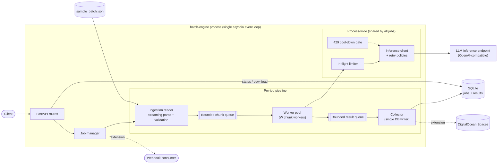
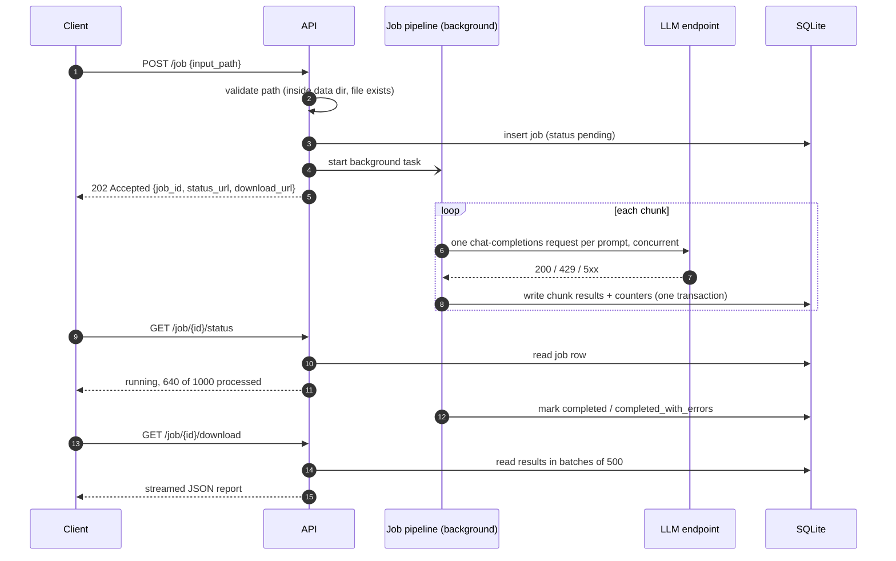
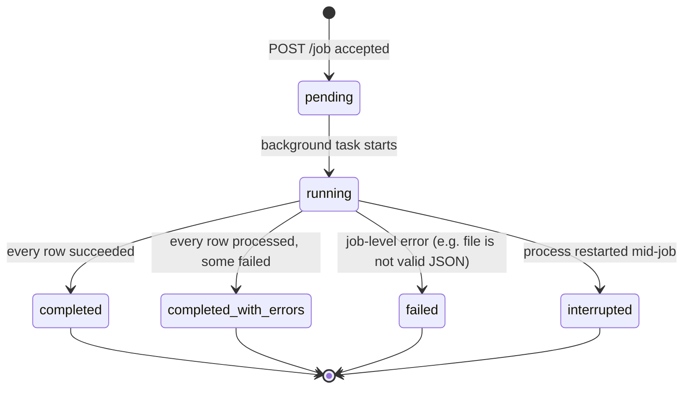
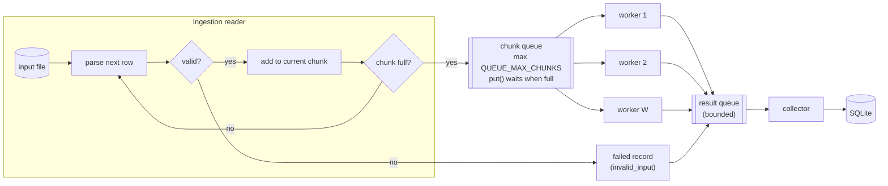
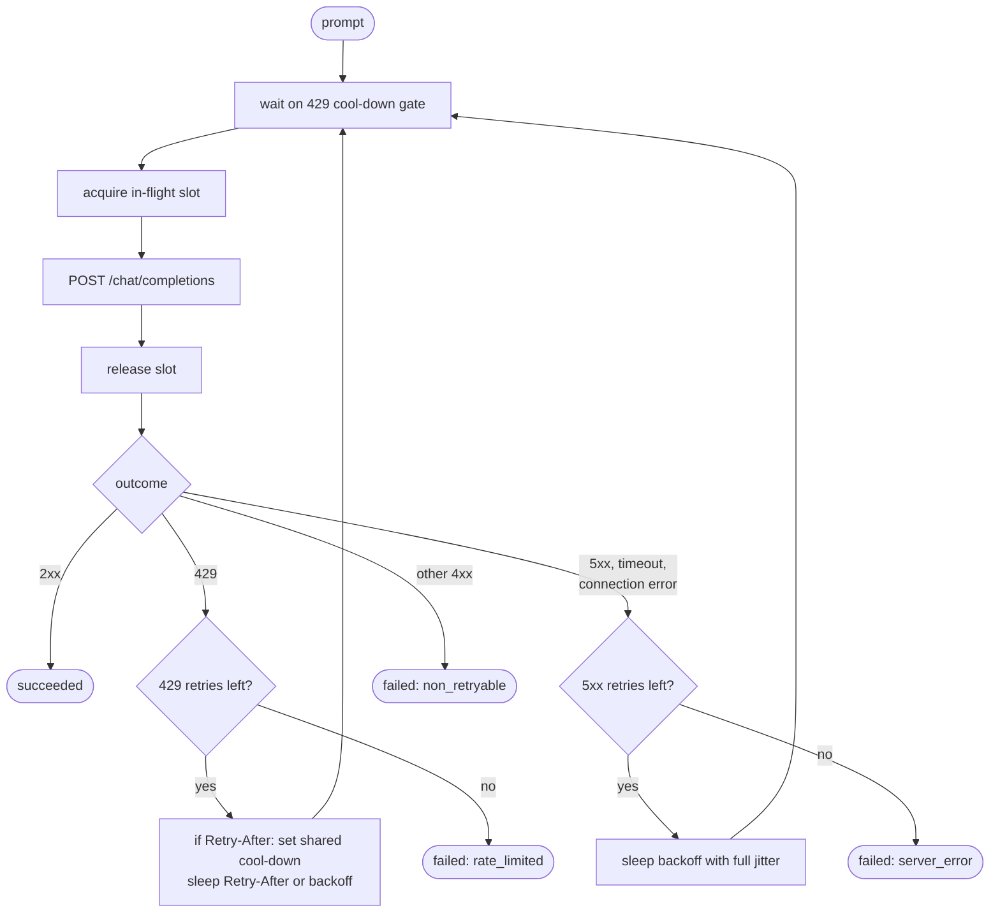
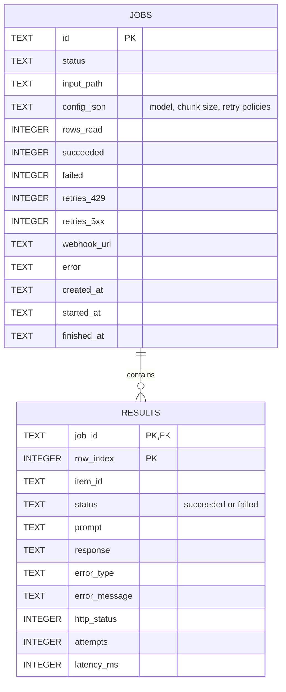
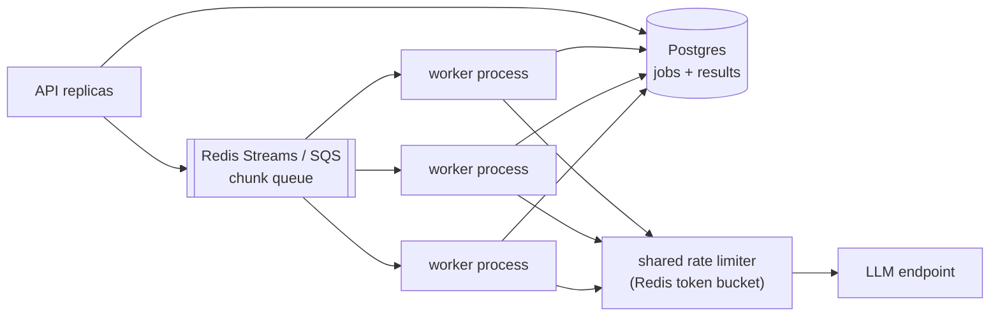

# Batch Inference Engine — Design

This document describes the architecture and key design decisions for the service specified in [spec.md](spec.md).

## 1. What it does

A REST service that takes a local JSON file of prompts, returns a Job ID immediately, and processes the prompts in the background against a live LLM inference endpoint. It survives rate limiting (HTTP 429) without dropping prompts, isolates per-prompt failures, and produces a structured report.

**Design goals**

- **Non-blocking API:** submitting a job never waits on inference.
- **Bounded resources:** memory stays flat whether the input has 1,000 or 500,000 prompts.
- **Resilience:** rate limits slow the job down but never lose prompts. Bad rows and persistent server errors fail individually, not the whole job.
- **Simple to run:** one Python process plus a SQLite file, with no external broker or database server.

**Out of scope for this build:** multi-host scale-out, authentication on the API, and provider batch APIs. Section 9 explains when and how to add them.

## 2. High-level architecture

Everything runs in **one Python process on one asyncio event loop**. The API and the job pipelines share the loop; the work is dominated by waiting on HTTP responses, so a single loop can keep hundreds of requests in flight.



| Component | Responsibility |
|---|---|
| **FastAPI routes** | Validate requests, create jobs, serve status, and stream downloads. |
| **Job manager** | Creates the job record, launches the pipeline as a background task, and tracks running jobs. |
| **Ingestion reader** | Streams the input file one row at a time, validates each row, groups valid rows into chunks, and pushes chunks onto the queue. |
| **Chunk queue** | An in-memory `asyncio.Queue` with a fixed max size. When it is full, the reader waits; this is the backpressure that bounds memory. |
| **Worker pool** | W workers. Each takes a chunk and sends all of its prompts concurrently. |
| **In-flight limiter** | A process-wide semaphore that caps total concurrent upstream requests across all workers and jobs. |
| **429 cool-down gate** | When the provider returns `Retry-After`, every worker pauses until that time instead of retrying immediately. |
| **Inference client** | A shared `httpx.AsyncClient` that applies the retry policy for each error class. |
| **Collector** | The only writer to the database. It writes each finished chunk in one transaction and updates job counters. |
| **SQLite** | Durable job state and per-prompt results, read by the status and download endpoints. |

## 3. Request lifecycle



### Job states



- **Row-level failures** (an invalid row, or a prompt that exhausted its retries) never fail the job. They are recorded and the job ends as `completed_with_errors`.
- **Job-level failures** are reserved for problems that stop ingestion, such as malformed JSON part-way through the file. Results written before that point are kept and still downloadable.
- On startup, any job still marked `running` is moved to `interrupted`. Because results are keyed by row index, such a job can be resumed later by skipping the rows that are already stored.

## 4. Scatter: chunking and the bounded queue

**Why chunks?** The chat-completions API takes one prompt per request, so chunking does not reduce the number of HTTP calls. A chunk is the unit of **scheduling and bookkeeping**: one queue entry, one database transaction, and one checkpoint, which the Spaces extension uploads. A prompt is the unit of **execution and retry**.



- **The queue is in memory.** It is an `asyncio.Queue(maxsize=QUEUE_MAX_CHUNKS)` in the same process, not a separate broker. If the process dies, queued chunks are lost, but they can be re-derived from the input file plus the rows already stored in SQLite.
- **Workers vs. the in-flight limit.** A worker fires all prompts in its chunk at once, and each prompt must acquire a slot from the shared limiter before sending. `WORKERS × CHUNK_SIZE` is set well above `MAX_IN_FLIGHT`, so the limiter, not the workers, sets throughput. A slow prompt only delays its own chunk's completion; other workers keep the slots busy.
- **Slots are released during back-off.** A request holds a slot only while the HTTP call is in progress, never while it sleeps before a retry.
- **Multiple jobs** each get their own reader, queue, workers and collector, but share the limiter and cool-down gate. Rate limits apply per API key, so total upstream pressure stays bounded however many jobs are running.

## 5. Calling the model: retries and backpressure

Each prompt becomes one `POST {INFERENCE_BASE_URL}/chat/completions` call with the configured model. The model defaults to a cheap 8B Llama, per the spec. The provider is any OpenAI-compatible endpoint; the default is DigitalOcean serverless inference.



### Separate retry policies for 429 and 5xx

Each error class has its own retry budget and back-off curve, configured by environment variables and overridable per job in the `POST /job` body.

| Setting | 429 (rate limited) | 5xx / timeout / network |
|---|---|---|
| Max retries | 8 | 3 |
| Base delay | 1.0 s | 0.5 s |
| Max delay (cap) | 30 s | 5 s |
| Multiplier | 2 | 2 |
| Honors `Retry-After` | yes, and pauses all workers | yes, for this request only |

- **Why different defaults:** the spec requires that rate limits never drop prompts, so the 429 budget is generous. It also requires persistent 500s to become isolated errors, so the 5xx budget is tight.
- **Back-off formula ("full jitter"):** `sleep = random(0, min(max_delay, base × multiplier^retry))`. The randomness spreads retries out so workers don't all retry at the same instant.
- **`Retry-After`:** when the provider sends it, the wait is that value plus up to 10% jitter, so workers don't all resume at the same instant.
- **Budgets are counted separately:** a prompt that hits two 429s and then a 500 has used 2 of 8 rate-limit retries and 1 of 3 server-error retries.
- **Other 4xx errors** (400, 401, 422) are not retried, because retrying cannot fix them.

## 6. Gather: storage and reporting

A single **collector** task consumes the result queue and writes each chunk to SQLite in one transaction, on a worker thread so the event loop never blocks. Having one writer avoids SQLite lock contention. WAL mode lets the status and download endpoints read while the collector writes.



- **Idempotent writes:** the primary key `(job_id, row_index)` with upsert means a re-processed chunk overwrites its rows instead of duplicating them.
- **Why SQLite rather than files:** job state survives restarts, counters are a query, writes are idempotent, and resuming is simple. It needs no server, and the store sits behind a small interface so Postgres can replace it for multi-host deployments.
- **Downloads are streamed:** rows are read in batches of 500 and written to the response as they are read. The full report is never built in memory.

## 7. API

| Method and path | Purpose | Responses |
|---|---|---|
| `POST /job` | Submit a job | `202` with the job ID; `400` if the request is invalid; `404` if the input file doesn't exist |
| `GET /job/{id}/status` | Progress and counters | `200`; `404` for an unknown job |
| `GET /job/{id}/download` | Final report | `200` streamed JSON; `409` if the job hasn't finished; `404` for an unknown job |
| `GET /healthz` | Liveness check | `200` |

**Submit.** Every field is optional. `input_path` defaults to the bundled sample and must resolve inside `DATA_DIR`.

```json
{
  "input_path": "sample_batch.json",
  "model": "llama3-8b-instruct",
  "chunk_size": 25,
  "webhook_url": "https://example.com/hooks/batch",
  "retry": {
    "rate_limit":   {"max_retries": 8, "base_delay_s": 1.0, "max_delay_s": 30},
    "server_error": {"max_retries": 3, "base_delay_s": 0.5, "max_delay_s": 5}
  }
}
```

**Status.** `rows_read` grows as the file streams in. `total` is `null` until ingestion finishes, because the file is never counted up front.

```json
{
  "job_id": "8f0c…",
  "status": "running",
  "rows_read": 1000, "total": 1000, "ingestion_complete": true,
  "processed": 640, "succeeded": 631, "failed": 9,
  "retries": {"rate_limited": 212, "server_error": 14},
  "created_at": "…", "started_at": "…", "finished_at": null
}
```

**Download.** Successful responses and isolated errors are kept in separate arrays, both in input order.

```json
{
  "job_id": "8f0c…",
  "status": "completed_with_errors",
  "summary": {"total": 1000, "succeeded": 991, "failed": 9},
  "results": [
    {"row_index": 0, "id": "prompt-000000", "prompt": "…", "response": "…", "attempts": 1, "latency_ms": 412}
  ],
  "errors": [
    {"row_index": 166, "id": "corrupt-missing-prompt", "error_type": "invalid_input", "message": "missing 'prompt'"},
    {"row_index": 402, "id": "prompt-000402", "error_type": "server_error", "http_status": 500, "attempts": 4}
  ]
}
```

**Input format.** The input is a JSON array of objects, each with a non-empty string `prompt` and an optional `id`. Rows that fail validation (a missing or empty prompt, a non-string prompt, or a value that isn't an object) are recorded as `invalid_input` errors and never sent to the model.

## 8. Memory footprint at 500,000 items

Nothing in the pipeline holds the whole dataset. Memory is capped by queue sizes, not by input size.

| Potential memory blow-up | How it is avoided |
|---|---|
| Loading the whole file (`json.load`) | `ijson` streams one row at a time. |
| Creating one task per prompt up front | Only `WORKERS × CHUNK_SIZE` prompts are in progress at any moment. |
| Reader outrunning the workers | The bounded chunk queue makes the reader wait. |
| Accumulating results in a list | The collector writes each chunk to SQLite and drops it. |
| Building the download response in memory | Rows are streamed out in batches of 500. |

With the defaults (`CHUNK_SIZE` 25, `WORKERS` 8, `QUEUE_MAX_CHUNKS` 16, result queue 16), at most about **1,000 prompts or results** are in memory at once: 400 queued, 200 in progress and 400 awaiting write. That is a few MB, the same for 1,000 or 500,000 rows. What grows with input size is the SQLite file on disk, roughly 0.5 GB for 500,000 rows with responses.

**Throughput** is set by `MAX_IN_FLIGHT` divided by average latency, and in practice by the provider's rate limit. With 32 in flight and about 1.5 s latency, that is roughly 20 requests per second: about 1 minute for 1,000 prompts, and about 7 hours for 500,000.

## 9. Scale thresholds

| Scale | First bottleneck | Approach |
|---|---|---|
| Up to ~1M rows, a few concurrent jobs | Provider rate limit (wall-clock time) | This design as is; tune `MAX_IN_FLIGHT` to the provider quota. |
| Jobs must survive host loss | Single disk and process | Spaces checkpointing (extension) and a resume endpoint. |
| Many concurrent jobs or multiple hosts | One event loop, one SQLite file | External queue, Postgres and horizontally scaled workers (diagram below). |
| Tens of millions of rows | Per-request overhead and cost | Provider batch APIs, if the provider offers them, instead of one request per prompt. |



The component boundaries in this build (reader, queue, workers, collector, store interface) map one-to-one onto that layout. Scaling out means swapping implementations, not redesigning.

## 10. Extensions

- **Real-time webhook:** if `webhook_url` is set, then when the job reaches a terminal state the service POSTs the job summary (the status payload) to it. Delivery runs as a background task with its own small retry policy. A webhook failure is logged and never changes the job's outcome. Only `http` and `https` URLs are accepted.
- **State streaming to Spaces:** after the collector commits a chunk, it also uploads that chunk's results as `jobs/{job_id}/chunks/{chunk_index}.jsonl` to a Spaces bucket through the S3-compatible API, plus a small `manifest.json` with the counters. Uploads run concurrently with a cap, so they don't stall the collector. If the host is lost, results can be rebuilt from the bucket.

## 11. Configuration

All settings are environment variables with sensible defaults. Secrets come only from the environment or a git-ignored `.env` file, and are never logged.

| Variable | Default | Meaning |
|---|---|---|
| `INFERENCE_BASE_URL` | `https://inference.do-ai.run/v1` | OpenAI-compatible endpoint |
| `INFERENCE_API_KEY` | none (required for live calls) | Bearer token |
| `INFERENCE_MODEL` | `llama3-8b-instruct` | Cost-efficient default model |
| `INFERENCE_MAX_TOKENS` | `128` | Response length cap |
| `INFERENCE_TIMEOUT_S` | `60` | Per-request timeout |
| `DATA_DIR` | `project/data` | Only directory jobs may read input from |
| `DB_PATH` | `project/var/batch_engine.db` | SQLite file |
| `CHUNK_SIZE` / `WORKERS` / `QUEUE_MAX_CHUNKS` | `25` / `8` / `16` | Scatter sizing |
| `MAX_IN_FLIGHT` | `32` | Process-wide concurrent request cap |
| `RETRY_429_MAX_RETRIES` / `_BASE_DELAY_S` / `_MAX_DELAY_S` | `8` / `1.0` / `30` | Rate-limit policy |
| `RETRY_5XX_MAX_RETRIES` / `_BASE_DELAY_S` / `_MAX_DELAY_S` | `3` / `0.5` / `5` | Server-error policy |

## 12. Testing strategy

Tests never touch the live endpoint. A **fake inference backend** stands in for the provider, using `httpx.MockTransport` in tests and a small standalone mock server for manual demos. It can be scripted to return 429s with `Retry-After`, 500s, timeouts and slow responses at chosen rates.

- **Unit tests:** back-off maths (bounds, cap, jitter, `Retry-After` parsing), separate retry budgets, row validation, chunking, the cool-down gate, and store idempotency.
- **Integration tests:** these drive the whole app through its HTTP API with the fake backend.
  - Happy path with 1,000 prompts.
  - A storm of 429s with zero dropped prompts.
  - Persistent 500s ending as isolated errors.
  - Corrupt rows.
  - Download format, and the 404 and 409 cases.
  - The queue never exceeding its bound.
- **CI:** a GitHub Actions workflow installs the project and runs the full suite on every push.

## 13. Project layout

```text
/workspaces
├── .github/workflows/ci.yml
├── README.md               quickstart + scale discussion
├── docs/
│   ├── spec.md             the problem statement
│   └── design.md           this document
└── project/
    ├── pyproject.toml
    ├── data/sample_batch.json
    ├── scripts/
    │   ├── make_sample.py      generates input files of any size
    │   └── mock_inference.py   local fake LLM endpoint
    ├── src/batch_engine/
    │   ├── api.py          client-facing tier: FastAPI app, routes, job manager
    │   ├── job_queue.py    queue tier: JobQueue interface + bounded in-memory queue
    │   ├── worker.py       worker tier: reader, workers, collector, webhook trigger
    │   ├── config.py       settings from environment
    │   ├── models.py       records, job states, request schema
    │   ├── ingest.py       streaming reader, validation, chunking
    │   ├── inference.py    HTTP client, limiter, cool-down gate
    │   ├── retry.py        retry policies and back-off maths
    │   ├── store.py        SQLite store
    │   └── webhook.py      completion callbacks (extension)
    └── tests/
        ├── unit/
        └── integration/
```
