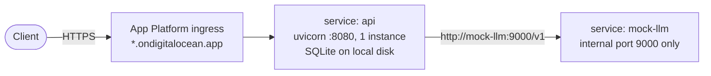

# 07: Deployment to DigitalOcean (from 14:28)

**Request:** deploy to the DigitalOcean project **`akhrot-interview-2`** (ID `a7442609-637f-48a0-9523-3dbd9dc991dd`), keeping the inference endpoint **mocked**.

## What was found

- `doctl` is authenticated (context `interview`, current). The account email is visible through `doctl account get`. The account status shows `warning`.
- **Droplet limit: 3, and 3 are in use** (`agents-s-2vcpu-4gb-nyc1`, `ingest-api`, `ubuntu-s-2vcpu-4gb-blr1`), all outside this project. A new droplet would be rejected. Deleting or reusing them is the user's call; they were not touched.
- The project had no resources yet. The account already has 4 App Platform apps in other projects.
- There is no Docker here, so building an image for the container registry (DOCR) isn't practical. App Platform must build from source, which means a **public GitHub repo** using the `git.repo_clone_url` source. A private repo would need DigitalOcean's GitHub app to be authorized in the console.

## Chosen approach: App Platform (`.do/app.yaml`)



- **Region:** `blr`. **Size:** `apps-s-1vcpu-0.5gb` for both services ($5/month each).
- **`api`:** built by the Python buildpack from `project/`, using `project/requirements.txt` and `project/.python-version` (3.13). It runs `uvicorn --app-dir src --factory batch_engine.api:create_app`. The health check is `/healthz`, and `INFERENCE_BASE_URL=http://mock-llm:9000/v1`.
- **`mock-llm`:** the same build, running `scripts/mock_inference.py`. It is reachable only inside the app (`internal_ports: [9000]`, no route).
- **Must stay at exactly 1 `api` instance:** the queue is in process and SQLite is on local disk. Job history is lost on every redeploy, because App Platform disks are ephemeral. That's acceptable for a demo with a mocked backend; the production fix is the Postgres plus Redis layout in design.md §9.
- **No authentication on the API.** It can only read files inside `DATA_DIR`, and the backend is a mock, so nothing costs money. Before using a real key, put it behind auth.
- **Validation:** `doctl apps spec validate .do/app.yaml` passes, both schema-only and full.

## Result (14:32–14:37)

- **14:33:** the user finished `gh auth login` (account `akhrot`). The agent created the public repo **https://github.com/akhrot/batch-inference-engine** with `gh repo create --public --source . --push`, after setting `repo_clone_url` in the spec.
- **CI:** the first run passed on Python 3.12 and 3.13 (`gh run watch --exit-status` exited 0). There were only deprecation notices: the Node 20 actions (`checkout@v4`, `setup-python@v5`) and `ubuntu-latest` moving to Ubuntu 26.
- **App:** `doctl apps create --project-id a7442609-…` created app ID **`33d7abde-59c4-44d3-92ad-6e401d19a631`**. It went from BUILDING to DEPLOYING to ACTIVE in about 100 s. URL: **https://batch-inference-engine-ibptc.ondigitalocean.app**.
- **Live smoke test:**
  - `/healthz` returned ok.
  - `POST /job` returned 202 immediately.
  - The 1,000 rows took about 30 s and finished `completed_with_errors`: 995 ok and 5 `invalid_input`, with 111 rate-limit retries, 21 server-error retries and zero drops. The report was 232 KB.
  - `rows_read` reached 550 while `processed` was still 0, then stayed bounded. The maximum lead is (16 queued + 8 in progress) × 25 = 600 rows, which shows the backpressure working.
  - An unknown job returned 404 and path traversal returned 400.

## Switch to a real model (15:04–15:22)

- **Dedicated options checked first.** No GPU droplet sizes are enabled for this team, and the droplet limit is 3/3. DigitalOcean's *Dedicated Inference* exists (it can even serve `llama3-8b-instruct`), but it is billed per GPU-hour from $2.59/hour and would need GPU quota. Rejected for a demo.
- **Serverless model choice:** from DigitalOcean's catalogue and pricing docs (verified 26 Oct 2026), Maverick (`llama-4-maverick`) is the only serverless Llama, at $0.25/$0.87 per 1M tokens. The choice was **Ministral 3 14B Instruct, `mistral-3-14B`**, at $0.20/$0.20: about $0.03 per 1,000-prompt run versus about $0.12 for Maverick. It is a non-reasoning model, so answers fit the 128-token cap.
- **Key:** the user put `INFERENCE_API_KEY` in `project/.env` (git-ignored, as is `/workspaces/.env`). `GET /v1/models` returned 82 models, including `mistral-3-14B`.
- **Local smoke test:** 50 of 50 succeeded in 3.3 s, averaging 2.0 s per request, with no 429s.
- **Live app update (user-approved):** `api` envs set to `INFERENCE_BASE_URL=https://inference.do-ai.run/v1`, `INFERENCE_MODEL=mistral-3-14B`, and `INFERENCE_API_KEY` as an **encrypted SECRET** (passed to `doctl apps update --spec -` through stdin, so it never touched disk or logs; it reads back as `EV[...]`). `mock-llm` is still running but unused. The repo's `.do/app.yaml` still describes the mock setup, and the secret is not committed.

### Live 1,000-prompt run against the real model (job `b0e28593…`)

| Metric | Value |
|---|---|
| Duration | 5 min 23 s |
| Result | `completed_with_errors`: **955 ok, 45 failed** (5 `invalid_input`, **40 `rate_limited`**) |
| 429 retries | **3,302**, with 0 server errors |
| Latency including back-off | avg 20.1 s, min 0.8 s, max 98 s |
| Attempts per successful prompt | avg 4.1, max 9 |

**What it shows**

- The default `MAX_IN_FLIGHT=32` is well above this key's rate limit. The first 200 prompts went through, then 429s dominated.
- Backpressure held: the reader stopped at 800 rows (200 in progress plus 600 queued).
- Status counters lag because they update per finished chunk. `processed` sat at 200 for about 80 s while retries were happening.
- 4% of prompts used up the 8-retry 429 budget. They were recorded as isolated `rate_limited` errors, not silently lost, but the spec asks for "without dropping elements".

### Tuned rerun (15:23–15:31, user-approved)

`MAX_IN_FLIGHT=8` was set on the live app by re-applying the app's own spec, in which the key reads back encrypted, so the key was never handled. The job was submitted with `{"retry": {"rate_limit": {"max_retries": 20, "max_delay_s": 60}}}`.

| Metric | Run 1 (32 in flight, 8 retries) | Run 2 (8 in flight, 20 retries) |
|---|---|---|
| Result | 955 ok, 5 invalid, **40 rate_limited** | **995 ok, 5 invalid, 0 rate_limited** |
| 429 retries | 3,302 | **1,754** |
| Duration | 5 min 23 s | 6 min 41 s |
| Attempts per successful prompt | avg 4.1, max 9 | avg 2.8, **max 11** |
| Latency including back-off | avg 20.1 s, max 98 s | avg 23.9 s, max 235 s |

**Conclusion:** with fewer requests in flight, about half as many calls were wasted on 429s, and the larger 429 budget ensured nothing was dropped. Some prompts needed up to 11 attempts, so the default budget of 8 would still have lost a few. The run took longer overall because the endpoint's limit, not our concurrency, sets the pace; adaptive concurrency would close that gap. The live app now keeps `MAX_IN_FLIGHT=8`. The 20-retry budget was a per-job override, not the default.

**Fixes, in order of effort**

1. Set `MAX_IN_FLIGHT` to about 8 on the app, so it stays under the provider limit (an env change, which redeploys the app).
2. Give the 429 policy a bigger budget, per job (`{"retry": {"rate_limit": {"max_retries": 20, "max_delay_s": 60}}}`) or as the default.
3. Adaptive concurrency (AIMD): halve the in-flight limit on 429s and raise it by one while requests succeed. This is a design improvement, not built.
4. A re-run endpoint for failed rows (resume), not built.

## Steps used (repeatable)

```bash
sed -i "s#github.com/akhrot/#github.com/<gh-user>/#" .do/app.yaml && git commit -am "Point app spec at repo" && git push
doctl apps create --spec .do/app.yaml --project-id a7442609-637f-48a0-9523-3dbd9dc991dd --wait
doctl apps list --format ID,Spec.Name,DefaultIngress
curl -s https://<default-ingress>/healthz
```

**Cleanup after the interview:** `doctl apps delete <app-id>`.
